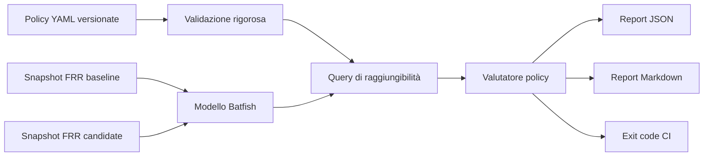

# NetChange Guard

**Documentazione inglese:** [README.md](README.md)

NetChange Guard trasforma l'intento di rete in controlli di policy eseguibili. Carica configurazioni
offline in Batfish, esamina l'intero spazio dei pacchetti corrispondenti e blocca una modifica quando
la raggiungibilità osservata non coincide con l'intento dichiarato.

Il laboratorio incluso rappresenta una rete aziendale fittizia con segmenti utenti, management,
servizi interni e DMZ. La baseline sicura supera tutte le quattro policy. La fixture candidate rimuove
deliberatamente una regola ACL, esponendo SSH nella rete di management; la demo riesce solo se questa
regressione viene rilevata.

> Stato: progetto di laboratorio. Non è stato usato in produzione e non dichiara di essere pronto
> per la produzione. Indirizzi, configurazioni e risultati sono interamente sintetici.

## Perché esiste questo progetto

I controlli sintattici non dimostrano il comportamento end-to-end. NetChange Guard verifica prima
del rilascio chi può raggiungere un servizio, con quale protocollo e porta. Batfish costruisce un
modello indipendente dal vendor usando gli snapshot; non serve accedere a dispositivi reali.

## Funzionalità

- Schema YAML versionato e rigoroso, con validazione anticipata.
- Analisi di raggiungibilità offline con Batfish su configurazioni FRRouting.
- Valutazione baseline/candidate e rilevamento esplicito delle regressioni.
- Report JSON per automazione e Markdown per revisione umana.
- Exit code adatti alla CI: `0` successo, `2` violazione di policy, `1` errore operativo/input.
- Fixture candidate vulnerabile per provare che il controllo rilevi una modifica reale.
- Test unitari, soglia di coverage, lint, type checking, audit dipendenze e workflow anti-segreti.

## Architettura



Consulta [Architettura](docs/architecture.it.md) e [Modello delle minacce](docs/threat-model.it.md).

## Topologia dimostrativa

```text
Utenti 10.10.10.0/24
          |
        edge
          | 10.0.0.0/30
        core -------- Management 10.20.20.0/24
          |  \
          |   +------ Servizi interni 10.30.30.0/24
          | 10.0.0.4/30
         dmz
          |
       LAN DMZ 10.40.40.0/24
```

La ACL baseline impedisce a utenti e workload DMZ di raggiungere SSH di management. La fixture
candidate rimuove il deny utenti-management lasciando invariati gli altri controlli.

## Requisiti

- Python 3.11+
- Runtime compatibile con Docker con almeno 4 GB di memoria disponibile
- Git (solo per lo sviluppo)

Non servono account cloud, servizi a pagamento, accesso a dispositivi o dati di reti reali.

## Avvio rapido

```bash
python -m venv .venv
source .venv/bin/activate  # Windows PowerShell: .venv\Scripts\Activate.ps1
python -m pip install --upgrade pip
python -m pip install -e ".[dev]"
docker compose up -d batfish
netchange-guard demo --policies policies/security.yml --report-dir reports
```

Riepilogo atteso:

```text
baseline=4/4 candidate=3/4 regressions=1
```

Con la candidate intenzionalmente insicura, `compare` restituisce exit code `2`; `demo` restituisce
`0` soltanto quando la baseline passa e viene rilevata esattamente la regressione prevista.

```bash
netchange-guard compare \
  --policies policies/security.yml \
  --baseline snapshots/baseline \
  --candidate snapshots/candidate \
  --report-dir reports
```

Per validare le policy senza Batfish:

```bash
netchange-guard validate --policies policies/security.yml
```

## Formato delle policy

```yaml
version: 1
policies:
  - id: users_no_ssh_to_management
    description: Le workstation utenti non devono aprire sessioni SSH verso il management.
    start_location: edge
    source: 10.10.10.0/24
    destination: 10.20.20.10/32
    protocol: tcp
    destination_ports: [22]
    expected: denied
```

Chiavi sconosciute, ID duplicati, reti malformate, protocolli non supportati, porte duplicate o fuori
intervallo vengono rifiutati prima di iniziare l'analisi.

## Verifica

Esegui il quality gate locale:

```bash
ruff check src tests
ruff format --check src tests
mypy src
pytest
pip-audit
```

I controlli realmente eseguiti per la versione pubblicata e i risultati osservati sono registrati
nel [Rapporto di verifica](docs/verification.it.md). I report in `reports/` derivano unicamente dalle
fixture fittizie e non contengono segreti o dati personali.

## Criteri di accettazione

- Lo snapshot baseline supera tutte le policy dichiarate.
- Lo snapshot candidate fallisce solo `users_no_ssh_to_management`.
- Il confronto identifica il fallimento come nuova regressione.
- Le policy malformate falliscono in modo chiuso prima di raggiungere Batfish.
- I report JSON e Markdown concordano su stato e conteggi.
- Test, lint, formattazione, type checking, audit dipendenze e scansione segreti passano.
- Un ambiente locale pulito può riprodurre la demo senza servizi a pagamento.

## Ambito e limiti

Inclusi: policy di raggiungibilità IPv4 TCP/UDP/ICMP, fixture FRRouting, analisi offline e confronto
baseline/candidate.

Esclusi: distribuzione delle configurazioni, collegamento ad apparati produttivi, telemetria runtime,
input di policy IPv6, autorizzazione applicativa e copertura garantita di ogni funzione vendor.
Batfish modella solo la semantica supportata: un report positivo è evidenza relativa al modello e alle
policy dichiarate, non sostituisce change management o rilascio graduale.

## Sicurezza

Usa solo snapshot sintetici e sanitizzati. Non inserire configurazioni produttive, credenziali o
indirizzamenti interni. Consulta [SECURITY.it.md](SECURITY.it.md) e il
[Modello delle minacce](docs/threat-model.it.md).

## Contributi e licenza

Consulta [CONTRIBUTING.it.md](CONTRIBUTING.it.md). Distribuito con [licenza MIT](LICENSE). Batfish e
le altre dipendenze mantengono le rispettive licenze; consulta le [attribuzioni](THIRD_PARTY_NOTICES.md).
