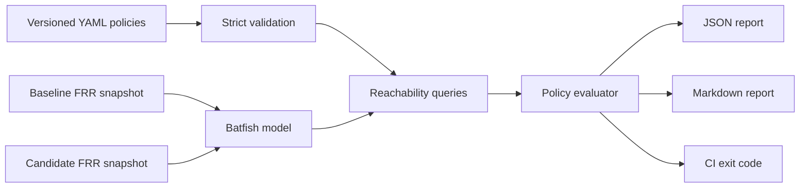

# NetChange Guard

**Italian documentation:** [README.it.md](README.it.md)

NetChange Guard turns network intent into executable policy checks. It loads offline device
configurations into Batfish, searches the complete matching packet space, and blocks a candidate
change when observed reachability differs from the declared intent.

The included lab models a fictional enterprise network with user, management, internal-service,
and DMZ segments. The safe baseline passes all four policies. The candidate fixture deliberately
removes one ACL rule, exposing SSH on the management network; the demo succeeds only when that
regression is detected.

> Status: laboratory project. It has not been used in production and makes no production-readiness
> claim. All addresses, configurations, and results are synthetic.

## Why this project exists

Configuration syntax checks cannot prove end-to-end behavior. NetChange Guard verifies business
intent before deployment: who can reach which service, using which protocol and port. Batfish builds
a vendor-independent model from the configuration snapshots; no access to live devices is required.

## Capabilities

- Strict, versioned YAML policy schema with early validation.
- Offline Batfish reachability analysis against FRRouting configurations.
- Baseline and candidate evaluation with explicit regression detection.
- Machine-readable JSON and reviewer-friendly Markdown reports.
- Meaningful exit codes for CI: `0` pass, `2` policy failure, `1` operational/input error.
- Deliberately vulnerable candidate fixture proving that the guardrail catches a real policy change.
- Unit tests, coverage gate, linting, static typing, dependency audit, and secret scanning workflow.

## Architecture



See [Architecture](docs/architecture.md) and [Threat model](docs/threat-model.md) for design details.

## Demo topology

```text
Users 10.10.10.0/24
          |
        edge
          | 10.0.0.0/30
        core -------- Management 10.20.20.0/24
          |  \
          |   +------ Internal services 10.30.30.0/24
          | 10.0.0.4/30
         dmz
          |
       DMZ LAN 10.40.40.0/24
```

The baseline ACL prevents users and DMZ workloads from reaching management SSH. The candidate
fixture removes the users-to-management deny rule while leaving the other controls unchanged.

## Requirements

- Python 3.11+
- Docker-compatible container runtime with at least 4 GB available memory
- Git (only for development)

No cloud account, paid service, device access, or real network data is needed.

## Quick start

```bash
python -m venv .venv
source .venv/bin/activate  # Windows PowerShell: .venv\Scripts\Activate.ps1
python -m pip install --upgrade pip
python -m pip install -e ".[dev]"
docker compose up -d batfish
netchange-guard demo --policies policies/security.yml --report-dir reports
```

Expected summary:

```text
baseline=4/4 candidate=3/4 regressions=1
```

The intentionally unsafe candidate makes `compare` return exit code `2`; `demo` returns `0` only
when the safe baseline passes and exactly the expected regression is caught.

```bash
netchange-guard compare \
  --policies policies/security.yml \
  --baseline snapshots/baseline \
  --candidate snapshots/candidate \
  --report-dir reports
```

To validate a policy file without Batfish:

```bash
netchange-guard validate --policies policies/security.yml
```

## Policy format

```yaml
version: 1
policies:
  - id: users_no_ssh_to_management
    description: User workstations must not open SSH sessions to management.
    start_location: edge
    source: 10.10.10.0/24
    destination: 10.20.20.10/32
    protocol: tcp
    destination_ports: [22]
    expected: denied
```

Unknown keys, duplicate IDs, malformed networks, unsupported protocols, duplicate ports, and
out-of-range ports are rejected before any analysis starts.

## Verification

Run the local quality gate:

```bash
ruff check src tests
ruff format --check src tests
mypy src
pytest
pip-audit
```

The exact checks executed for the published version and their observed outcomes are recorded in
[Verification record](docs/verification.md). Committed reports under `reports/` are generated only
from the fictional fixtures and contain no secrets or personal data.

## Acceptance criteria

- The baseline snapshot passes every declared policy.
- The candidate snapshot fails only `users_no_ssh_to_management`.
- The comparison identifies that failure as a new regression.
- Malformed policy files fail closed before reaching Batfish.
- JSON and Markdown reports agree on status and counts.
- Unit tests, lint, formatting, type checks, dependency audit, and secret scan pass.
- A clean local environment can reproduce the demo without paid services.

## Scope and limitations

Included: IPv4 TCP/UDP/ICMP reachability policies, FRRouting fixtures, offline analysis, and
baseline/candidate comparison.

Not included: pushing configurations, connecting to production equipment, runtime telemetry,
IPv6 policy input, application-layer authorization, or support guarantees for every vendor feature.
Batfish models only supported configuration semantics; a passing report is evidence about the model
and declared policies, not a substitute for change control or staged deployment.

## Security

Use synthetic, sanitized snapshots only. Do not commit production configurations, credentials, or
internal addressing. See [SECURITY.md](SECURITY.md) for vulnerability reporting and
[Threat model](docs/threat-model.md) for trust boundaries and mitigations.

## Contributing and license

See [CONTRIBUTING.md](CONTRIBUTING.md). Released under the [MIT License](LICENSE). Batfish and all
other dependencies retain their own licenses; see [third-party notices](THIRD_PARTY_NOTICES.md).
